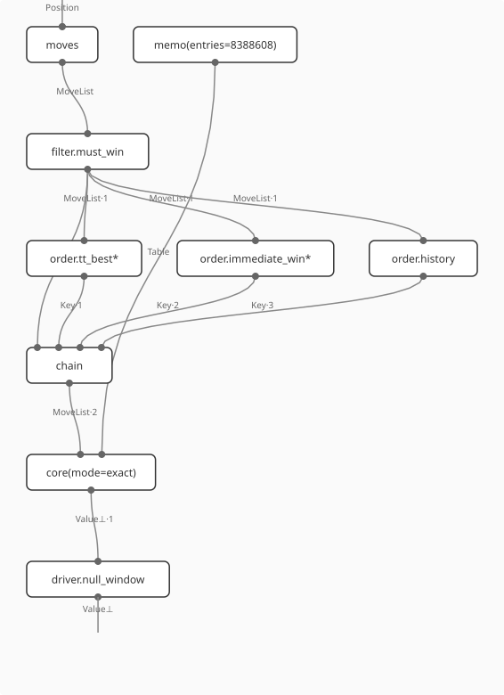
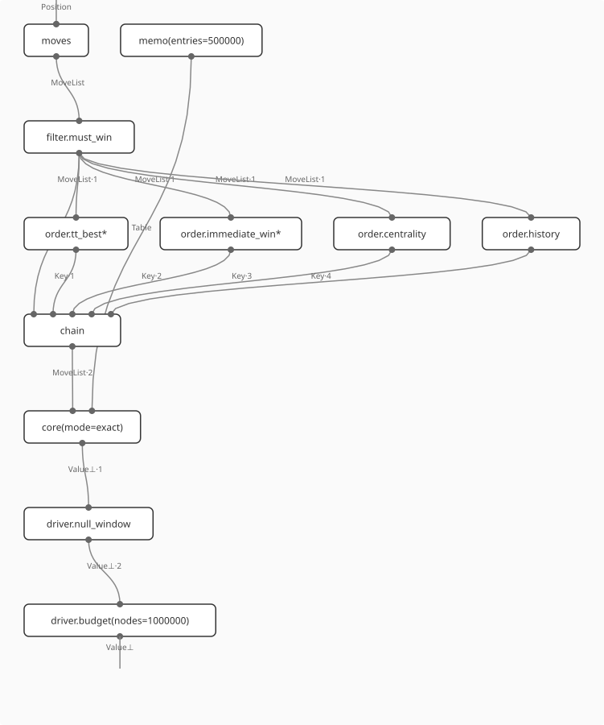
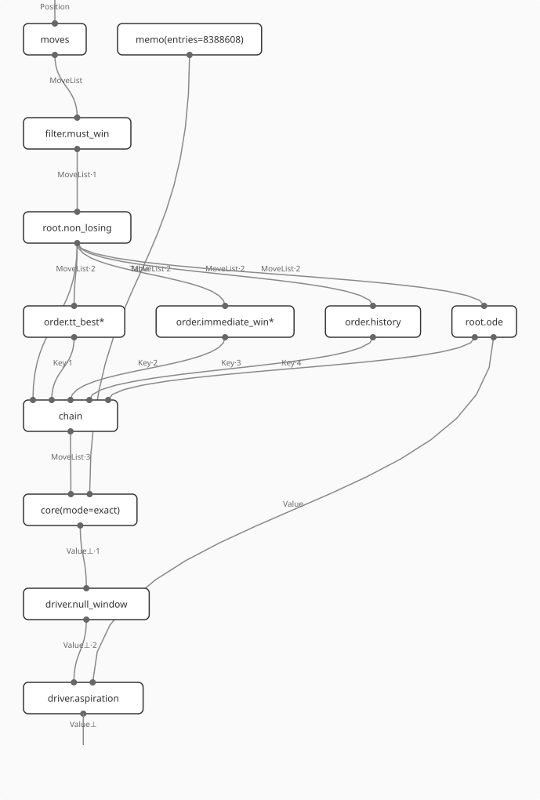
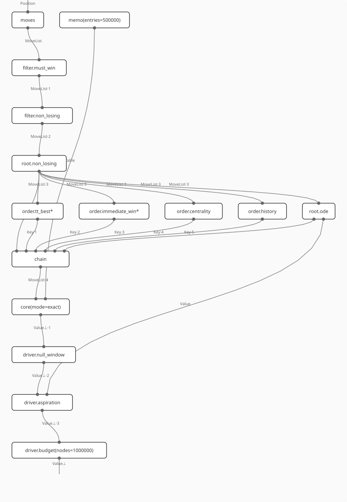

# How the search pieces compose: diagrams and laws

Slice 6 of the composable search pieces ([search-pieces-roadmap.md](search-pieces-roadmap.md)). It draws a `SearchPlan` as one string diagram, and holds each law the pieces were said to obey to a test. Where the code does not obey a law, this page says what it does instead. No test was weakened to pass: each test asserts what the code does.

- **The code.** `pflow-metamodel` at branch `search-pieces-slice6`, from main `9ce3d43` (slices 2 to 4).
  - New: `Chain::then` (order.rs), `SearchPlan::normalized` and `SearchPlan::net` (plan.rs), and the `plan_net` example.
  - Changed: a plan now refuses a driver listed twice. Before, a second budget silently replaced the first, and could erase its `ms`.
  - Defaults are unchanged. The golden gate (`search_gate` against `tests/golden/search-gate.txt`, 5,568 lines) is identical.
- **The tests.**
  - `tests/search_laws.rs`, one test per law, named after the law (`o1_…` to `c1_…`).
  - Unit tests where private types are needed: O5 in `src/game.rs`, B1 and B2 in `src/memo.rs`.
  - The net tests in `tests/search_plan.rs`.
- **Positions.** Tic-tac-toe (the first 400 reachable positions) and the Connect-3 sample. Node counts are only compared between fresh solvers, because a solver's history carries over from one call to the next.
- **The ontology.** Concepts are cited by IRI from ontology-pflow-xyz `ns/search.ttl` and `ns/diagrams.ttl` (main `705dc1b`):
  - `op:` = `https://ontology.pflow.xyz/op/`
  - `sk:` = `…/searchkind/`
  - `ct:` = `…/contract/`
  - `wt:` = `…/wiretype/`
  - `piece:` = `…/piece/`

  The release served at ontology.pflow.xyz, 0.2.0, does not yet include the search or diagram modules, so none of these IRIs resolves there yet.
- **chyp-rs.** The equational theories are in chyp-rs `laws/*.chyp` (commit `8af1423`). chyp-rs is a local repository with no remote, so only the file and the law are named here. A chyp proof checks consequences of the file's own rules, taken as axioms. It does not check pflow-rs: the tests here are the check against the code.

## A plan as one composite

`SearchPlan::net()` returns a Petri net in pflow.xyz's editor shape (Shape A JSON):

```
{"@context", "@type": "PetriNet", "@version": "1.1", "places": {id: {"@type": "Place"}},
 "transitions": {id: {"@type": "Transition"}}, "arcs": [{"@type": "Arrow", source, target, weight}]}
```

pflow-native's `view.string_diagram` is a port of pflow.xyz's diagram viewer. It draws each transition as a box labeled by its id, and each place as a typed wire: input ports on top and output ports below, both in arc order. A place with no producer enters from the top, and a place with no consumer leaves at the bottom.

The net draws the plan as `SearchPlan::normalized()` states it, with every default made explicit. It goes top to bottom in the order the code composes the pieces, not the order the JSON lists them:

| Box (transition id) | Inputs | Output | Code |
|---|---|---|---|
| `moves` | `Position` | `MoveList` | `Walk::moves` |
| `filter.must_win`, `filter.non_losing` (code order) | `MoveList·k` | `MoveList·k+1` | game.rs:990, 1011 (every node) |
| `root.non_losing` | `MoveList·k` | `MoveList·k+1` | `Solver::rank` (the root only) |
| `order.<piece>`, with `*` marking a decisive piece | `MoveList·k` | `Key·i` | `Orderer::key` |
| `root.<estimate>` (`root.ode`) | `MoveList·k` | `Key·n+1`, and `Value` with aspiration | game.rs:1020, the estimate's rank breaks the chain's ties |
| `chain` | `MoveList·k`, then `Key·1..n+1` in priority order | `MoveList·k+1` | `Chain::key`, `Chain::before` |
| `memo(entries=N)` | none | `Table` | `Solver::with_memo` |
| `core(mode=exact\|play)` | the ordered `MoveList`, `Table` | `Value⊥` | `Solver::search` |
| `driver.null_window`, `driver.aspiration` (takes `Value`), `driver.budget(nodes=N,ms=T)` | `Value⊥·i` | `Value⊥·i+1` | `Solver::solve`, `run`, the node check at game.rs:945 |

The wire ids are the ontology's wire types (`ns/diagrams.ttl`):
- `Position` is `wt:position`, `MoveList` is `wt:move-list`, `Key` is `wt:key`, `Value` is `wt:value`, `Table` is `wt:table` (the side wire of `sk:memo`), and `Value⊥` is `wt:value-or-none`.
- Each wire id is numbered with `·k`, because a place id is its label and has to be unique.
- `wt:move` is not drawn. In the ontology an order piece's box is `Move → Key`. A flat net has no map over a list, so each piece's box reads the whole `MoveList` instead.

What the drawing shows, law by law:
- **The chain.** The `chain` box is the flat normal form of the chain monoid (O1). The empty chain is a `chain` box with only the list as input. Swapping two pieces swaps which box feeds `Key·1`, so it gives a different net (O4).
- **Sets.** Filters, root pieces and drivers listed in any order give the same net (F1, R1, D1).
- **Defaults.** A plan that leaves a default out gives the same net as one that states it (P1).
- **Drivers.** They are always drawn in the one order the code runs them: `budget` is outermost, with its arguments in its id.

Limits of the view:
- **No nesting.** A driver is drawn as a `Value⊥ → Value⊥` box, read as wrapping everything above it, rather than as a functor box around the core (`op:wrap` and `op:fill` draw nesting; this view cannot).
- **Aspiration** is drawn as its own driver after `null_window`. In the code it is not a separate wrapper (game.rs:885-912). With `null_window` on, it picks which yes/no search `null_window` runs first. With `null_window` off, it is a window an eighth of the range wide around the guess, with the full range as fallback.
- **Long wires** (`Table`, `Value`) cross boxes, because the view does not route around them.
- **Book.** It is not drawn. A book is attached with `Solver::with_book` after the solver is built and is not part of a plan's JSON.

### The diagrams

The nets are committed as `crates/pflow-metamodel/tests/golden/plan-*.json`, and `tests/search_plan.rs` (`a_plan_draws_as_a_net_the_parser_reads`) holds `SearchPlan::net()` to them byte for byte. The same test reads each net back with `pflow_parser::model_from_json` and checks that the composite has one input (`Position`) and one output (`Value⊥`).

1. The default plan, `{}`:

   

2. `plan:connect4-exact`, the ontology's stored plan:
   `{"mode":"exact","order":["tt_best","immediate_win","centrality","history"],"drivers":["null_window",{"budget":{"nodes":1000000}}],"memo":{"entries":500000}}`

   

3. The root ODE with `non_losing` and aspiration:
   `{"root": {"order": ["ode", "non_losing"]}, "drivers": ["null_window", "aspiration"]}`

   

4. plan.rs's module-doc example. It has every slot filled and is not the ontology's `plan:connect4-exact` any more (see "Ontology drift"):

   

To regenerate them, build pflow-native's CLI in a pflow-native checkout. The SVGs here came from the detached worktree `.pflow-native-render` at `a85d17d`. The view does not depend on pflow-rs's pin. Then:

```sh
(cd <pflow-native> && cargo build --release -p pflow-native-cli)
docs/diagrams/render.sh <pflow-native>/target/release/pflow-native-cli
```

For each plan, `render.sh` runs the following. Two runs gave byte-identical SVGs.

```sh
cargo run -q -p pflow-metamodel --example plan_net -- '<plan json>' > crates/pflow-metamodel/tests/golden/<name>.json
printf '[{"command": "view.string_diagram", "args": {}}, {"command": "export.artifact", "args": {"format": "svg", "path": "docs/diagrams/<name>.svg"}}]' \
  | pflow-native-cli -i crates/pflow-metamodel/tests/golden/<name>.json batch -
```

The JSON is written as text in a fixed key order, so pflow-rs (serde_json without `preserve_order`) and pflow-native (with it) see the same bytes.

## The laws

| # | Law | Verdict | Test |
|---|---|---|---|
| O1 | Chains are a monoid under `then` | holds (partial: at most 8 pieces) | `o1_chains_are_a_monoid_under_then` |
| O2 | The default chain is not the unit | holds | `o2_the_default_chain_is_not_the_unit` |
| O3 | A repeated piece changes nothing | holds in behaviour; a plan cannot state it | `o3_a_repeated_piece_changes_nothing` |
| O4 | Chains do not commute | holds (they do not) | `o4_chains_do_not_commute` |
| O5 | The composite chain is lexicographic | does not hold: keys are cut at a decisive piece | `game::tests::chains_compose_as_keys_cut_at_a_decisive_piece` |
| O6 | `must_win` absorbs `immediate_win` on ±1 games | holds | `o6_must_win_absorbs_immediate_win` |
| F1, F2 | Filters commute and are idempotent | holds, as flags rather than a composition | `f1_f2_filters_are_a_set` |
| F3 | No filters is the unit, not the default | holds | `f3_no_filters_is_the_unit_not_the_default` |
| F4 | Every set of filters keeps the values | holds | `f4_every_set_of_filters_keeps_the_values` |
| F | Filters are a meet-semilattice of move sets | does not hold | (F1-F6 hold what does) |
| F5 | `non_losing` drops only lost moves | holds | `f5_non_losing_drops_only_lost_moves` |
| F6 | Root `non_losing` is absorbed by the filter | holds | `f6_root_non_losing_is_absorbed_by_the_filter` |
| B1 | Bounds are an interval meet | holds in lo and hi only | `memo::tests::stores_meet_in_lo_and_hi_and_the_last_best_wins` |
| B2 | A pin absorbs stores | holds | `memo::tests::a_pin_absorbs_stores_and_stays_pinned` |
| D1 | Driver order matters | does not hold for a plan: the list's order is ignored | `d1_driver_order_is_ignored` |
| D2 | A budget truncates | holds on these nets, with caveats | `d2_a_budget_truncates` |
| D3 | `budget ∘ budget = budget` | cannot be stated: two budgets are refused | `d3_two_budgets_are_refused` |
| D4 | No drivers is the identity | holds | `d4_no_drivers_is_the_identity` |
| D5 | `null_window` is the identity below three rewards | holds | `d5_null_window_is_the_identity_below_three_rewards` |
| R1 | Root pieces are a set | holds | `r1_root_pieces_are_a_set` |
| P1 | Equal normal forms are one plan | holds | `p1_plans_with_one_normal_form_are_one_plan` |
| C1 | `choose` is deterministic | holds | `c1_choose_is_deterministic` |

Node counts below are totals over each net's positions (400 on tic-tac-toe, 40 on Connect-3), each position solved by a fresh solver. Numbers come from `cargo test -p pflow-metamodel --test search_laws -- --nocapture`.

### Orderers (`sk:order`, `op:chain`)

**O1. Chains are a monoid under `then`. Holds (partial).**
- `Chain::then` concatenates two chains. It is associative, and its unit is `Chain::new(&[])`.
- The monoid is partial. Like `Chain::new`, `then` refuses more than 8 pieces, and the test shows the two groupings are refused together, exactly when the total is over 8.
- `Chain` takes a repeat; only a plan refuses one.
- Ontology: `op:chain` ("A monoid: the empty chain is the identity and chaining is associative"; "A partial one in code").
- chyp-rs `laws/orderers.chyp`: axioms `chain_assoc`, `chain_unitL`, `chain_unitR`; proofs `chain4_bracketing`, `connect4_chain`, `nil_middle`, `nil_padding`.
- Its header says repeats are refused by "order.rs MAX_PIECES, plan.rs". Only plan.rs refuses them; MAX_PIECES limits the length.

**O2. The default chain is not the unit. Holds.**
- Leaving `order` out gives `[tt_best, immediate_win, history]`; `"order": []` is the unit. Both give the same values.
- Nodes, tic-tac-toe: 18,690 against 19,893.
- Nodes, Connect-3: 4,293 against 7,533.
- Ontology: `ns:inDefault` on `piece:tt_best`, `piece:immediate_win`, `piece:history`.
- chyp-rs: `nil` in `orderers.chyp` (the unit). The default chain is not in the theory.

**O3. A repeated piece changes nothing. Holds in behaviour; a plan cannot state it.**
- `[a, a]` and `[a]`, and `[a, b, a]` and `[a, b]`, give identical values and nodes for every piece and pair.
- A repeated piece only reads the same key again, so it never decides anything.
- `history` listed twice counts each cutoff twice. That doubles every count and leaves the order unchanged.
- A plan refuses the repeat ("is listed twice"), so idempotence holds for `Chain` but cannot be written in a plan.
- Ontology: `op:chain` ("SearchPlan refuses a piece listed twice").
- chyp-rs: not stated. `orderers.chyp` is the free monoid and has no idempotence rule.

**O4. Chains do not commute. Holds: they do not.** The values are the same. The nodes:

| pair | tic-tac-toe | Connect-3 |
|---|---|---|
| `[tt_best, history]` / reversed | 18,690 / 17,992 | 4,293 / 7,485 |
| `[centrality, history]` / reversed | 13,322 / 15,252 | 4,138 / 5,474 |
| `[immediate_win, centrality]` / reversed | 13,096 / 13,096 | 3,592 / 3,592 |

The last pair is the same both ways because of O6: under `must_win`, `immediate_win` never gives a nonzero key.
- chyp-rs `orderers.chyp`: `chain_not_comm` and `chain_not_comm_concrete`, rejected `by refl`.

**O5. The composite chain is lexicographic. Does not hold.** What does hold is that keys are cut at a decisive piece.
- `Chain::key` stops at the first decisive piece with a nonzero key (order.rs:260). The unit test checks this over every third tic-tac-toe position, every move, and 12 chains paired every way:
  - `(A then B).key` is A's keys followed by B's, unless a decisive piece of A gave a nonzero key. In that case the rest of the key is zeros.
  - So composition is concatenation that stops at a decisive key. The monoid behind it is a key string with a "stopped" flag: `(k, true)·y = (k, true)` and `(k, false)·(k', s) = (k ++ k', s)`. It is associative with unit `(ε, false)`, and `Chain::key` maps into it.
  - Prefix refinement holds: a move A orders strictly before another stays before it in A then B.
  - The lexicographic composite of the two comparisons does not hold. The test finds moves that `[immediate_win]` then `[centrality]` ties, because both win at once, although their centrality differs. Comparing A first and then B would separate them.
- So "the composite is lexicographic" (ontology-pflow-xyz ROADMAP Phase 6, quoted in `orderers.chyp`) is true piece by piece, not chain by chain.
- Ontology: `op:chain`'s comment already says this correctly ("only up to a decisive piece's nonzero key"); `ns:decisive`.
- chyp-rs: `orderers.chyp`'s header notes the decisive tier is outside its theory.

**O6. On ±1 games, `must_win` absorbs `immediate_win`. Holds.**
- With `must_win`, `[tt_best, immediate_win, history]` and `[tt_best, history]` give identical values and nodes.
- The reason: a move that wins at the best bound settles the node while the children are generated (game.rs:990), before any key is compared. On these nets every win is at the bound.
- Without filters the values are the same and `immediate_win` saves nodes:
  - tic-tac-toe: 26,133 against 37,909;
  - Connect-3: 6,029 against 21,177.
- So in the default plan, `immediate_win` is dead weight on games that pay ±1. It would matter on a game whose wins pay less than the bound.
- Ontology: `piece:immediate_win`, `piece:must_win`.
- chyp-rs: none. A law across two kinds is in no file.

### Filters (`sk:filter`, `op:seq`)

**F1, F2. Filters commute and are idempotent. Holds, as flags.**
- `with_filters([must_win, non_losing])` and the reverse give identical values and nodes, and so do the two plan orders. So does `[must_win, must_win]` against `[must_win]`; a plan refuses the repeat.
- The reason is that `Filters::of` (filter.rs:75) turns the list into two flags. The search applies them in one fixed order:
  1. `must_win` while children are generated;
  2. `non_losing` after that;
  3. the root's retain after that.
- Ontology: `op:seq` says filters are composed "in the order listed". For the built filters the list order is ignored.
- chyp-rs `laws/filters.chyp`: `meet_comm`, `meet_idem` (axioms), `meet_comm_concrete`, `legal_idem`.

**F3. No filters is the unit; the default is `must_win`. Holds.**
- `"filters": []` and the default give the same values.
- With the default: tic-tac-toe 18,690 nodes against 26,133 (-28.5%); Connect-3 4,293 against 6,029 (-28.8%).
- chyp-rs `filters.chyp`: `all`, `meet_unitL`, `meet_unitR`.

**F4. Every set of filters, in either order, finds the default values. Holds.**

**Filters are a meet-semilattice of move sets. Does not hold.**
- **`must_win` filters no moves.** It settles the node at the first move, in the net's order, that ends the game at the mover's best bound. It skips the order chain and records the cutoff in history (game.rs:990-997). Read as a filter, it keeps "the winning moves, else all moves".
- **When `non_losing` drops every move, the position is settled at the worst bound** (game.rs:1011). It does not fall back to all moves. The value is the same.
- **`non_losing`'s test is incomplete.** With goals declared, only the replies that feed a goal are tried (filter.rs `Filters::lost`), so the kept set can be larger than the truly non-losing moves. That is sound.
- **Ontology drift.** The ontology's `op:seq` comment and `piece:must_win` / `piece:non_losing` say "an empty result falls back to all moves". So does ontology-pflow-xyz ROADMAP Phase 6. They should say the position is settled at the worst bound.
- chyp-rs: `filters.chyp`'s header gives a counterexample to associativity under that fallback. It cannot occur in pflow-rs today, because `non_losing` is the only filter that drops moves.

**F5. `non_losing` at the root drops only lost moves. Holds.** Across both nets it dropped 914 moves. After each one, a fresh search finds the mover's worst bound, and every kept move is one of the position's moves. Ontology: `ct:sound-pruning`.

**F6. Root `non_losing` with the `non_losing` filter is the filter alone. Holds.**
- Values and nodes are identical. Both use the same predicate (`Filters::lost`).
- Without an estimate, the root's ranking keeps the net's order, so the sort is unchanged.
- When every move is dropped, both paths count one node.

### Bounds (`sk:bound`, `sk:memo` with side wire `wt:table`)

**B1. Bounds are an interval meet. Holds in lo and hi only.**
- Storing on a key the table already holds sets `lo = max`, `hi = min` (memo.rs:291).
- Over every interval on {-1, 0, 1}, the unit test shows this meet is commutative, associative and idempotent, with the whole range as its unit and an empty interval (lo > hi) absorbing.
- The rest of the entry does not meet:
  - `best` is the last writer's, so storing the unit overwrites it;
  - `work` is the maximum;
  - the age is refreshed on every store.
- An evicted entry starts again at the whole range, so the table as a whole does not only accumulate knowledge. Values do not depend on that: `a_memo_bounds_the_table_not_the_value`.
- Ontology: `sk:bound` is "designed", with no built piece. ontology-pflow-xyz ROADMAP Phase 6 says "Bounds: interval meet. Neither is built". The table is built and is that meet.
- chyp-rs: no law file covers bounds.

**B2. A pin absorbs stores. Holds.**
- A book's pinned entry met with a later store is unchanged and stays pinned. A pin after a store is the meet, and pinned.
- A store outside a pin's value, which is what a wrong book entry does, leaves an empty interval. The search then returns one end of it (game.rs:957-962), unnoticed. book.rs says it directly: "a wrong value in it is a wrong value out".

### Drivers (`sk:driver`, `op:wrap`)

**D1. Driver order matters. Does not hold for a plan.**
- `["null_window", budget]` and `[budget, "null_window"]` give identical values (or `None`) and nodes, at budgets of 3 and 3,000,000 nodes.
- The code always runs budget(null_window(core)). The node count is reset once per call and checked at every node, so one budget covers all of `null_window`'s yes/no searches.
- `null_window(budget(core))`, a budget per yes/no search, cannot be built. As diagrams the two orders differ (chyp-rs `laws/drivers.chyp`: `driver_orders_differ` and `solver_is_not_swapped`, both rejected, with the definition `solver = core ; null_window ; budget` and `solver_unfold`).
- Ontology: `op:wrap`'s drawing rule ("operand 1, the driver a plan lists first, is innermost") matches the code only when budget is listed last. `op:wrap`'s own comment says so. `SearchPlan::net` draws the code's order.

**D2. A budget truncates. Holds on these nets, with caveats.**
- For every position, with `null_window` on and off, let n be the nodes the search needs. Then:
  - a budget of n or n + 1 gives the same value in exactly n nodes;
  - a budget of n - 1 or n/2 gives `None` with the count at budget + 1.
- The caveats: a budget is not a hard cap.
  - When the bit engine meets a marking it cannot hold, the count starts again for the counts engine (game.rs:860). That happens on no position here.
  - The root's ODE solves and `non_losing`'s replies are not counted.
  - `ms` reads the clock every 1,024 nodes, so a time budget is not deterministic.
- Ontology: `piece:budget`, `ct:partial`.

**D3. `budget ∘ budget = budget`. Cannot be stated.**
- Before this slice, a second budget replaced the first (`d.budget = b.nodes; d.ms = b.ms`). So `[{"budget":{"ms":5}}, {"budget":{"nodes":5}}]` silently lost its time budget, and two budgets came to neither their minimum nor any other meet.
- Now a plan refuses any driver listed twice, as it already refused a repeated order piece, filter or root piece. The tests are `d3_two_budgets_are_refused` and `search_plan::drivers_listed_twice_are_refused`.
- chyp-rs `drivers.chyp`'s `budget_idem` (axiom) and `budget_rewrap` (theorem) therefore have nothing in a plan to check against.

**D4. No drivers is the identity. Holds.**
- `"drivers": []` runs one search over the whole range, with the same values as `["null_window"]` and different nodes:
  - tic-tac-toe: 17,690 against 18,690;
  - Connect-3: 3,890 against 4,293.
- On these small nets the single search is the cheaper one.
- `["null_window", "null_window"]` is now refused.
- chyp-rs `drivers.chyp`: `plain_id`, `plain_dropped`.

**D5. With fewer than three rewards, `null_window` is the identity. Holds.** A game whose rewards take two values has no gap to step through (game.rs:885). The test uses a net with no goals.

### Root pieces (no ontology kind yet)

**R1. Root pieces are a set. Holds.**
- `root.order` as `["ode", "non_losing"]` and as `["non_losing", "ode"]`, with or without aspiration, give identical values, nodes and `root_order`. The estimate is a noise estimate named `ode`.
- In the code, moves are dropped first and then the rest are ranked (`Solver::rank`). That is the order `normalized()` writes.
- Ontology: no `sk:estimate` and no root slot yet. `ode` appears only as a comment calling it an orderer, which is stale.
- chyp-rs: none.

### Whole plans (`op:fill`)

**P1. Plans with one normal form are one plan. Holds.**
- `normalized()` states every default: the default chain, `[must_win]`, `[null_window]`, an empty root, and `Solver::MEMO` entries.
- It lists every set in the order the code runs it, and keeps the chain as listed.
- It is idempotent.
- Three groups of plans that differ only in list order or stated defaults give the same normal form, identical nets, and identical values and nodes.
- Ontology: `op:fill`. The ontology's canonical `ns:planJson` keeps list order and has no `root` key, so it is a different normal form from this one.

**C1. `choose` is deterministic. Holds.**
- Two fresh solvers of one plan choose the same move, value, exactness and node count at every position.
- The plans tested include play mode under a 20-node budget with the ODE root.
- No time budget is used, and the search has no hashed iteration order (`HashMap` appears only in tests).

### Other findings

- **Builder order matters.** The `with_*` setters are applied in order and the last call wins. `with_memo` builds a new table, so a book attached before it is lost. `SearchPlan::solver_with` calls `with_memo`, so a book goes on after it.
- **`Solver::root_order` is not the order the search tries the root's moves.** It is the root pieces' ranking alone. The search sorts by the chain first and uses that ranking only to break ties (game.rs:1020).
- **Ontology drift.** The ontology describes pflow-rs `c396d46`:
  - `op:wrap`'s comment gives `Drivers` as a flag and a node budget;
  - `op:seq` says no filter is built;
  - there is no `aspiration`, `ode`, root slot or `ms`.

  plan.rs's module-doc example now fills every slot, so it is no longer `plan:connect4-exact`, which the ontology's drift test compares it with. The drift test's pattern for the default drivers predates slice 3's `aspiration` and `ms` fields.

  This slice kept byte-identical the source text that test reads: the default-drivers block, `kind_of`, `enum Kind`, the `DRIVERS`/`ESTIMATES`/`UNSOUND` lines, `Piece::NAMES`, `Piece::parse`, `Chain::default` and `needs_goals`.
